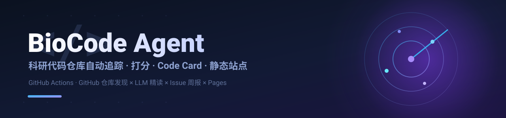

<p align="center">
  
</p>

<h1 align="center">BioCode Agent</h1>

<p align="center">
  <strong>科研代码仓库（GitHub repo）自动追踪 + AI 精读模板</strong><br/>
  用 GitHub Actions 每周自动「替你搜一遍研究领域」：每日免费元数据流 + 每周关键词盲搜 → 合并去重 → LLM 按 README 打分 → 高分仓库 <b>代码语料摘录</b>（源码/文档/构建文件；数据与二进制不入库）+ AI wiki（DeepWiki · Code Wiki · zread）快照归档 → LLM 生成一张「Code Card」→ 开一条 GitHub Issue 周报 → 部署一个可全文检索的 Pages 站点。
</p>

<p align="center">
  
  
  
  
  
  
</p>

<p align="center">
  <a href="#-三步上手">三步上手</a> ·
  <a href="#-设计思路">设计思路</a> ·
  <a href="#-流水线各阶段">流水线</a> ·
  <a href="#-agent-与-noagent-模式切换">模式切换</a> ·
  <a href="#-无-ai-时的降级行为">无 AI 降级</a> ·
  <a href="#-code-card-与站点">Code Card 与站点</a> ·
  <a href="#-搜索要点">搜索要点</a> ·
  <a href="#-密钥与仓库配置">密钥与配置</a> ·
  <a href="#-打分与周报的配置项">打分与周报配置</a> ·
  <a href="#-本地运行与调试">本地运行</a> ·
  <a href="#-部署清单">部署清单</a> ·
  <a href="#-faq">FAQ</a>
</p>

> **模板即实例。** 仓库内的 `config.yaml`、`prompts.yaml`、`queries/` 与 `monitor/lists/` 已内置一套完整可跑的示例——以 **「固有无序区 / 无序蛋白（IDR/IDP）× 相分离 / 生物分子凝聚体」** 为默认课题。拿到后你只需改**几个文件**：`config.yaml`（换课题与检索式）、`prompts.yaml`（换领域措辞）、`monitor/lists/*.txt`（换你关注的领域内的大佬 / 课题组）、`queries/search_repos.yaml`（可选，换盲搜式）。核心驱动为自研工具 [ghresearcher](https://github.com/MaybeBio/GhResearcher) 与 [repowiki-cli](https://github.com/MaybeBio/Repowiki-cli)。

---

## 🚀 三步上手

| 步骤 | 你要做的 | 具体内容 |
|---|---|---|
| **1 · 换课题** | 编辑 [`config.yaml`](./config.yaml) 与 [`prompts.yaml`](./prompts.yaml) | 改 `topic` / `title` / `search.queries`，换 `prompts.yaml` 里 2 个 prompt 的领域措辞（课题词就写在这里）；填 `monitor/lists/*.txt` |
| **2 · 设密钥与 Pages** | 配置 Secrets / Variables 与 Pages | **Settings → Secrets and variables → Actions** 添加 `LLM_BASE_URL` / `LLM_API_KEY`（secrets）、`LLM_MODEL`（variable）；要 zread 归档再加 `ZREAD_TOKEN`（secret）。**Settings → Pages** 来源选 **GitHub Actions**。改 `config.yaml` 的 `site_base_url` |
| **3 · 每周收报** | GitHub 原生 `schedule` 自动触发（每周日 08:00 上海时区），也可手动 `workflow_dispatch` | 有新仓库时自动开一条 **Issue 周报**，提交 `data/` 与 `code/`，并重建 **Pages 站点**：按分数排序，逐仓库一张 Code Card，支持全文检索 |

> **每周日自动跑。** `weekly-discovery` 每周日 08:00、`daily-feed` 每日 05:00（上海时区）自动运行；站点按运行的抓取窗口分组，周一打开 Issue 与 Pages 即可看到过去一周。需要补跑时在 Actions 页手动 `workflow_dispatch`。

### 🔄 换课题（最终操作）

1. GitHub 上 **Use this template** 建新仓库
2. 改 [`config.yaml`](./config.yaml)：`topic`（slug，站点标题兜底）、`title`、`window_days`、`search.queries`（盲搜式）、`github_repo` / `github_branch`（本仓库的 owner/name + 默认分支，用于构造 wiki 快照链接）、**`site_base_url`**（见「部署清单」）
3. 改 [`prompts.yaml`](./prompts.yaml)：`score` 与 `code_card` 两段 prompt 里与领域相关的措辞（**课题词只在这里定义**，LLM 直接用）
4. 填 [`monitor/lists/`](./monitor/lists) 三个清单：`users.txt` / `orgs.txt` / `users_core.txt`（每行一个真实 GitHub 用户或 org；`users_core.txt` 必须是 `users.txt` 的**子集**，它只收窄更嘈杂的 received 流）
5. 配 Secrets / Variables（见「密钥与仓库配置」）
6. **先启用 Pages**：Settings → Pages，来源设为 **GitHub Actions**（不启用则站点不会部署）
7. 手动 `workflow_dispatch` 跑一次 `weekly-discovery` 验证

> 推送到 `main` 后可在仓库 **Actions** 页手动触发试跑；想先本地验证见「本地运行与调试」。

---

## 💡 设计思路

- **双通道发现，宽召回 + 打分过滤** —— 每日走免费事件流（你关注的大佬/课题组），每周走关键词盲搜；合并成候选池后统一交给 LLM 打分。
- **以 `pushed_at` 判断更新** —— star/watch/fork 会更新 `updated_at`，只有真实代码 push 才更新 `pushed_at`；搜索先按 `--updated` 粗筛，再由客户端精筛。
- **代码与 wiki 一起归档** —— 高分仓库摘录代码语料；三个第三方 AI wiki 没有版本历史，故每周落一份快照，只增不删。
- **AI 写卡片，人做判断** —— 每个高分仓库生成一张 Code Card，降低上手与移植的判断成本。
- **Issue 即提醒，站点即沉淀** —— 有命中才开 Issue；静态 Pages 永久沉淀每周产出，可全文检索。
- **密钥不入库** —— 凭据一律走环境变量或 Actions Secret。
- **一个课题一个仓** —— 同一骨架可复制成多个独立仓库。

---

## 🔀 流水线各阶段

| 阶段 | 脚本 | 触发 | 输入 → 输出 |
|---|---|---|---|
| **每日动态** | `scripts/daily.py` | `daily-feed` workflow | 你关注的 领域内users/orgs → `monitor/{users,orgs,received}/…txt` + `data/daily/{date}.repos.json` + 每日 Issue |
| **每周盲搜** | `scripts/search.py` | `weekly-discovery` | `search.queries` 逐条 `gh search repos` → `data/search/{date}.json`（按 `pushed_at` 客户端过滤） |
| **合并去重** | `scripts/merge.py` | 同上 | 窗口 `[run-window_days, run-1]` 内的每日 feed ∪ 本周盲搜 → `data/candidates/{date}.json`（按 `full_name` 去重） |
| **LLM 打分** | `scripts/score.py` | 同上 | 候选池 → LLM 按 README 打 0–10 分 + 一句话 → `data/scored/{date}.json` |
| **归档** | `scripts/archive.py` | 同上 | 高分仓库 → 代码语料摘录（`repo_copy=code`）+ 三 wiki 快照 → `code/{repo}/` + `data/archive/{date}.json` |
| **Code Card** | `scripts/cards.py` | 同上 | 高分仓库 README + 目录树 + 依赖 → LLM 生成一张卡片 → `data/cards/{date}.json` |
| **Issue + CSV** | `scripts/issue.py` | 同上 | 打分结果 → `data/weekly/{date}.csv` + 每周 Issue（并记 `data/latest_issue.txt`） |
| **静态站点** | `scripts/build_site.py` | `deploy-pages` workflow | 遍历 `data/` + `code/` → 渲染 `site/` → 部署到 Pages |

一次完整的每周流水线 = `bash scripts/run_weekly.sh`（`search → merge → score → archive → cards → issue`）。若候选量太大，可把 `ingest.mode` 切成 `daily`，见下一节。

---

## ⚡ 运行模式：weekly（默认）与 daily 增量

候选量小的课题用 `weekly`；单周上千时改用 `daily`，把搜索与打分分摊到每天。

```yaml
# config.yaml
ingest:
  mode: weekly        # weekly（默认）| daily
  max_backfill_days: 2
```

| | `weekly`（默认） | `daily` |
|---|---|---|
| 每天 05:00 `daily.yml` | watchlist feed + 每日 Issue | 同上，**再加** `search(昨天) → merge → score` |
| 周日 08:00 `weekly.yml` | `search → merge → score → archive → cards → issue` | `aggregate → archive → cards → issue` |
| 归档 / Code Card | 每周一次 | 每周一次（不变） |

归档与 Code Card 始终每周执行一次，避免同一仓库一周产生 7 层 wiki 快照。daily 某天失败时，weekly 会按 `max_backfill_days`（默认 2）补跑缺失日期。从 `weekly` 切到 `daily` 的第一周只有切换后的数据；私有仓库需注意每月 Actions 免费额度。

---

## 🕹 agent 与 noagent 模式切换

要不要 AI，由一个开关显式决定（`llm.enabled`，默认 `true`）：

```yaml
# config.yaml
llm:
  enabled: true          # true = agent 模式（默认）；false = noagent 模式
archive:
  repo_copy: code        # agent 推荐 code；noagent 建议改成 readme
```

| 阶段 | agent 模式（默认） | noagent 模式 |
|---|---|---|
| `score.py` | LLM 打 0–10 分 + 一句话 | 不打分：`score=None`、`one_liner` 用 description 兜底 |
| `archive.py` | 高分仓库（`score ≥ min_score`） | **只留 watchlist 来源**（按 stars 降序），搜索仓库不进归档 |
| `cards.py` | LLM 生成 Code Card | 不调 LLM，只抓 README + 目录树存盘 |
| `issue.py` | 表含 score / one_liner 两列 | 去掉 AI 两列，按 stars 排序 |
| 站点 | 分数徽章 + Code Card + README + 目录树 | 无分数、无卡片，只渲染 README + 目录树 |

切到 noagent 只需 `llm.enabled: false`，建议同时把 `archive.repo_copy` 改为 `readme`。没有打分就无法从搜索噪声中筛选，因此 noagent 只保留 watchlist 来源。

---

## 🧯 无 AI 时的降级行为

AI 环节只有打分与 Code Card 两处，行为取决于 LLM 变量是否存在：

| | 完全不设 `LLM_BASE_URL` / `LLM_API_KEY` | 设了变量但 key 无效 |
|---|---|---|
| 流水线 | 在 score 步骤中断 | 能跑完 |
| `data/scored` | 不生成 | 全部 `score=null` |
| Issue / CSV | 不生成 | 生成，分数列为 `-` |
| Code Card / 归档 / 站点 | 无 | 无（`min_score` 过滤后为空） |

站点只从 `data/cards/` 取数，没有卡片即没有内容。

需要保留仓库清单时，直接切 noagent（`llm.enabled: false`）；不想改配置可临时设占位变量，让流水线降级为「有候选、无分数」：

```bash
export LLM_BASE_URL=http://localhost LLM_API_KEY=x
```

---

## 🃏 Code Card 与站点

站点由 `build_site.py` 从 `data/` 与 `code/` 生成，纯静态，由 `deploy_pages.yml` 部署。页面包括本周推荐、按周归档、全文搜索与仓库详情。

**Code Card 六节**（`prompts.yaml` 的 `code_card` 定义，输出单字段 `{"card": "<markdown>"}`）：

```
## 是什么 · ## 亮点 · ## 为何对本课题有用 · ## 怎么用 · ## 核心 idea · ## 可搬移点
```

「怎么用」由 README、目录树与依赖文件共同支撑；「核心 idea / 可搬移点」面向移植。

**两套链接口径：**

| 路径 | 含义 | 何时用 |
|---|---|---|
| `site/repos/{repo}/` | **最新**（latest-wins） | 首页 / 站内搜索，永远指向最近一次卡片 |
| `site/weeks/{week}/repos/{repo}/` | **当周冻结快照** | 周归档页，链到**当周那一刻**的卡片与 wiki 快照 |

卡片详情页提供 deepwiki、codewiki、zread 的实时链接；有快照时链接到 `code/{repo}/wikis/{date}/{source}/llms.txt`。

**站内搜索（两段式索引）**：索引在导出阶段预生成，浏览器端完成检索——

| 索引 | 文件 | 字段 | 加载时机 |
|---|---|---|---|
| 头索引 | `site/data/search.json` | 仓库名、一句话、语言、stars、日期 | 页面加载即取 |
| 深索引 | `site/data/search-deep.json` | Code Card + README 全文的纯文本 | 勾选「深度搜索」时惰性拉取 |

---

## 🧩 搜索要点

**时间窗以 `pushed_at` 为准。** star/watch/fork 会更新 `updated_at`，但不改变 `pushed_at`。`gh search repos` 没有 `--pushed`，且 `pushed:` 与 `in:` 组合会被忽略，因此先用 `--updated` 粗筛，再由 `search.py` 按 `pushedAt` 客户端精筛到 `[运行日 - window_days, 运行日 - 1]`。

> 查询拆成多条，是因为 GitHub 限制每条查询最多 5 个 AND/OR/NOT 运算符；各查询按 `full_name` 取并集。

---

## 🔑 密钥与仓库配置

LLM 与 zread 凭据一律走环境变量，**不写入仓库**：

| 用途 | 名称 | 类型 | 必填 |
|---|---|---|---|
| LLM 网关地址 | `LLM_BASE_URL` | Secret | AI 必填 |
| LLM API key | `LLM_API_KEY` | Secret | AI 必填 |
| LLM 模型 | `LLM_MODEL` | **Variable** | 可选（默认 `deepseek-chat`） |
| zread 归档 token | `ZREAD_TOKEN` | Secret | 可选（缺则 zread 只复用旧快照） |
| 每日动态 / Issue | `GITHUB_TOKEN` | 内置 | 自动（workflow 已声明 `contents/issues: write`） |

- 本地：`export LLM_BASE_URL=... LLM_API_KEY=... LLM_MODEL=...`。
- GitHub Actions：**Settings → Secrets and variables → Actions**，分别建 Repository **secrets** 与 **variables**，workflow 以 `${{ secrets.* }}` / `${{ vars.* }}` 注入。
- **`ZREAD_TOKEN`**：浏览器登录 zread.ai 后，在 DevTools 中取 `JSON.parse(localStorage.getItem('CGX_AUTH_STORAGE')).state.token`。它只用于 `repowiki-cli zread submit`；缺失时只复用已有快照。

**调度**：`daily.yml` 每日 05:00、`weekly.yml` 每周日 08:00（`Asia/Shanghai`），均保留 `workflow_dispatch`。窗口统一为 `[run-window_days, run-1]`，站点按该窗口分组。原生 `schedule` 只在默认分支生效，高负载时可能延后。

**手动触发**：Actions 页选择 `weekly-discovery` 或 `daily-feed` → **Run workflow**。`deploy-pages` 会在 weekly 成功后自动运行，通常不需要手动触发。

**模型选型提示**：打分走 `response_format={"type":"json_object"}`，所选模型必须支持 JSON mode（DeepSeek 的 `deepseek-reasoner` 通常不支持，不能直接替换）；评分要忠实、不宜用思考/推理模式。

---

## ⚙️ 打分与周报的配置项

`config.yaml` 里有三个与「打多少、打谁、周报列多少」相关的开关。它们互相配合，建议先读这一节再调。

### `llm.score_sources`：哪些来源参与 LLM 打分

候选池由两路合并而成，每条候选的 `source` 是一个**列表**（不是字符串）：

| 来源 | `source` |
|---|---|
| 每日关注流（`users` / `orgs` / `users_core` 的 feed） | `["watchlist"]` |
| 关键词盲搜 | `["search"]` |
| 两边都命中 | `["watchlist", "search"]` |

`score_sources` 决定谁真的送去 LLM：

| 值 | 行为 | 适用 |
|---|---|---|
| `search`（**默认**） | 只打含 `search` 的；纯 watchlist 保留 `score=None` | 配额有限、关注流噪声大 |
| `all` | 全部候选都打 | 关注清单很干净、想全量覆盖 |
| `watchlist` | 只打关注流 | 只跟踪指定课题组 |

- 两边都命中的仓库含 `search`，`search` 模式下**仍会打分**；
- 没被选中的仓库**不会消失**：仍在 `data/candidates/`、`data/scored/`，`score=None`，下游 `threshold` 自动排除（不进 Issue / 站点 / 归档）；
- 老数据没有 `source` 字段时，按「参与打分」保守处理，不会静默丢仓库。

> 实测（某一周 514 个候选）：仅 search 421、仅 watchlist 91、两者都有 2。`search` 比 `all` 少约 18% 的 LLM 调用。

### `issue.show`：周报 Issue 列多少

GitHub Issue 正文上限 **65536 字符**。候选一多（几百上千），全表会直接触发
`GraphQL: Body is too long (maximum is 65536 characters) (createIssue)`，而 workflow 若用 `|| true` 会把失败吞掉——Issue 静默不生成。

| 值 | 行为 |
|---|---|
| `all`（**默认**） | 列出全部候选（适合候选 < ~300 的课题） |
| `high` | 只列 `score >= llm.min_score` 的仓库（与归档 / Code Card 同口径） |

- `high` 模式下标题里的数量也是高分仓库数，不是候选总数；
- 全量候选仍保留在 `data/weekly/{date}.csv`；
- **daily 模式**聚合一周后可能有两千多候选，`all` 必然超限，建议直接设 `high`。

### `llm.concurrency` 与全局限速

真正的吞吐上限由 `scripts/agent.py` 的全局限速控制，不是 `concurrency`：

- 默认每 7.5 秒放行一次（约 8 次/分钟），所有线程共享；用 `LLM_MIN_INTERVAL` 覆盖（秒，0 关闭）；
- `concurrency: 8` 只是同时等待的线程数，需要 ≥ 请求耗时 / 7.5s（请求通常 5~15s）；调到 2 反而喂不满限速。

重试：429 优先遵循 `Retry-After`；`APIConnectionError` 每个仓库最多 3 次；429/5xx 最多退避 8 次（单次上限 60s）。

### 时间预算（可选扩展）

若你的课题单日候选量波动很大，可以给打分加一个墙钟上限（蛋白结构实例的 `llm.max_seconds` 就是这么做的）。注意必须满足：

```
max_seconds(软截止)  <  步骤 timeout-minutes  <  job timeout-minutes
```

到点后剩余仓库标记 `[llm budget exhausted]` 并立即落盘，保证后续 `commit` 一定执行——**job 超时会跳过 commit，直接丢掉当天数据**。本模板的 `scripts/score.py` 暂未内置这个预算逻辑，需要时可按该实例扩展。

---

## 💻 本地运行与调试

```bash
pip install -r requirements.txt
pip install ghresearcher pyrepowiki-cli   # 搜索/监控 + wiki 归档（PyPI）
npm install -g degit                      # 完整克隆（repo_copy=full 与 tree API 回退时用）
gh auth login                             # 供 gh api / gh search 使用

export LLM_BASE_URL=... LLM_API_KEY=...   # 可选 LLM_MODEL=...

# 每日：免费元数据流 + Issue 正文
python scripts/daily.py --config config.yaml \
    --issue-body /tmp/issue.md --issue-title /tmp/issue.title

# 每周：search → merge → score → archive → cards → issue
bash scripts/run_weekly.sh

# daily 模式：抓「昨天」→ merge → score（weekly 模式下会直接跳过）
python scripts/ingest_daily.py --config config.yaml
# daily 模式：聚合本周的 7 份 scored（缺天会按 max_backfill_days 补跑）
python scripts/aggregate.py --config config.yaml

# 站点：从 data/ + code/ 重建 site/
python scripts/build_site.py --out-dir . --config config.yaml
```

**测试：** `tests/` 是 pytest 自检用例（不参与部署，可安全删除）。

```bash
python -m pytest -q
```

---

## ✅ 部署清单

从「Use this template」到站点跑通，逐项打勾：

- [ ] **`site_base_url` 必填** —— 填成 `https://<user>.github.io/<repo>`。留空会导致站内链接 404。
- [ ] **启用 Pages** —— Settings → Pages，**Source = GitHub Actions**（不启用则 `deploy_pages.yml` 直接失败）。
- [ ] **Secrets / Variables** —— `LLM_BASE_URL` / `LLM_API_KEY`（secret）、`LLM_MODEL`（variable）、`ZREAD_TOKEN`（可选 secret）。
- [ ] **`github_repo` / `github_branch`** —— 改成新仓的 `owner/name` 与默认分支，wiki 快照链接才会指对。
- [ ] **监听清单** —— 填 `monitor/lists/{users,users_core,orgs}.txt`（`users_core` ⊂ `users`）。
- [ ] **确认调度** —— `daily-feed` 每日 05:00、`weekly-discovery` 每周日 08:00（上海时区）；改时间就改 workflow 里的 `cron`。
- [ ] **首次试跑** —— Actions 里手动 `workflow_dispatch` 跑一次 `weekly-discovery`，确认 Issue 与 Pages 都出得来。

> **手动 push 不会触发部署。** `deploy_pages.yml` 由 `weekly-discovery` 的 `workflow_run` 触发；需要手动部署时运行：`gh workflow run deploy_pages.yml --repo <owner>/<repo> --ref main`。

---

## 🚧 待改进：打分吞吐

一个仓库一次 LLM 请求，候选上千时容易撞 workflow 超时。已落地：全局限速、`Retry-After`、连接重试与 `score_sources` 来源过滤。仍可考虑批量打分（一次 5 个仓库，需处理串号与批次失败）或去掉搜索里的 `readme` 降低候选量；若仍超时，换用不限速的付费端点。

---

## ❓ FAQ

<details>
<summary><b>能不能不要 AI？</b></summary>

可以，设置 `llm.enabled: false`，见「agent 与 noagent 模式切换」。凭据未配好的行为见「无 AI 时的降级行为」。
</details>

<details>
<summary><b>README 在不同环节截断不同，为什么？</b></summary>

同一个仓库的 README，喂给 LLM 的截断（超长 README 既撑爆上下文又稀释注意力），给人搜/给人看的保留全文（便于溯源命中词上下文）：

| 环节 | 喂什么 | 截断点 |
|---|---|---|
| 打分 score | README 前 **10,000** 字符 | `scripts/agent.py` `score_repo` 的 `readme[:10000]` |
| card 生成 | README 前 **40,000** 字符 + 目录树 + 依赖清单 | `scripts/cards.py` `_README_CAP = 40000` |
| 存盘 | **全文** | `card_record` 的 `readme` 字段 |
| 搜索 deep 索引 | **全文** | `scripts/build_site.py` `_build_search_documents` |
| 详情页 | **全文**（折叠「README 原文」） | `templates/code.html` |

前两档是「喂给 LLM」的，后三档是「展示/搜索/溯源」的，两套截断互不影响。
</details>

<details>
<summary><b>代码目录为什么不是完整仓库？</b></summary>

`archive.repo_copy: code`（默认）把高分仓库当「代码语料」而不是备份，保留四类：**源码**（语言后缀）、**构建/配置**（Makefile、Dockerfile、`requirements*.txt`、`pyproject.toml`、`package.json`、`*.yaml/.toml/.ini` 等环境与依赖清单）、**README**（正则匹配各种大小写与语言变体，如 `README_zh.md`）、**文档**（`.md/.rst/.tex` 及 `LICENSE`、`CHANGELOG` 等）。**数据、图片、权重、二进制、通用 `.txt/.log/.csv/.json/.xml` 一律不留**；大小上限分三类——普通源码 >2 MB、文档/构建配置 >1 MB 才砍，**README 与 `.ipynb` 不设限**（notebook 是「代码+结果」的完整产物，整份保留）——实测 24 个仓库里源码最大 0.46 MB、文档最大 0.27 MB、构建最大 79 KB，而 XML / JSON 数据能到 8 MB，砍掉的都是后者。每个仓库的 `code/{repo}/MANIFEST.md` 由归档时自动生成：保留/省略的统计、体积最大的 20 个省略文件及其 `raw/HEAD` 取回链接都在里面，并明确写着「这是代码摘录，不是完整仓库」。

下载走 `--filter=blob:none` 的 partial clone + sparse-checkout：先按 tree API 的 size 选文件，再只拉清单内的 blob。实测一个 655 MB 的仓库只下载 44 MB；一周 24 个仓库的语料约 35 MB（原来完整克隆是 1.1 GB）。README 和文档里的相对图片/链接会改写成 GitHub 绝对地址，所以图片即使没存下来也能正常渲染。需要完整仓库时把 `repo_copy` 改成 `full`；只要 README + 目录树则用 `readme`（`TREE.md` 由归档时自动生成）；tree API 被截断时自动退回完整克隆 + 本地裁剪。

</details>

<details>
<summary><b>wiki 为什么要按周打快照？</b></summary>

deepwiki / codewiki / zread 是第三方 AI **现算**的产物，上游**没有版本历史**——对方一重新生成，旧版本就永久消失，且每次因随机性与侧重不同会有差异。故把它们当**积累材料**而非缓存：**只增不删**，每周按抓取日期落一份到 `code/{repo}/wikis/{date}/{deepwiki,google_code_wiki,zread}/`。

是否新打一份，看该 wiki **自身**的更新日期是否落在本周（deepwiki 用 `last_modified`、zread 用 `updated_at`、codewiki 用 `commit_sha` 反查提交日期）；没更新且已有旧快照则记 `reused` 不再新打。代码语料（`code/{repo}/code/`）不受此规则影响，每周照常覆盖重建——代码本身在 GitHub 上有 git 历史，无需本地攒快照。
</details>

<details>
<summary><b>并发设多大？</b></summary>

`llm.concurrency`（默认 8）是「同时跑的仓库数」，每个仓库会**串行**调用 LLM 1~2 次（打分，高分再加卡片），失败还会重试。若你的网关对单 key 有速率限制（例如 SJTU 网关约 10 次/窗口），并发要**明显低于**该限制——出现大量 `429` 时反而应继续调低。`archive.concurrency`（默认 4）是 degit + repowiki 的网络并发，太高会触发 repowiki 限流。
</details>

---

> 这是一个刻意保持通用的**模板仓库**：属于你的只有 `config.yaml`、`prompts.yaml`、`queries/search_repos.yaml` 与 `monitor/lists/`，脚本、模板、工作流、测试基本不必动。把它复制成「一个课题 = 一个独立仓库」，即可同时追踪多个研究方向。
